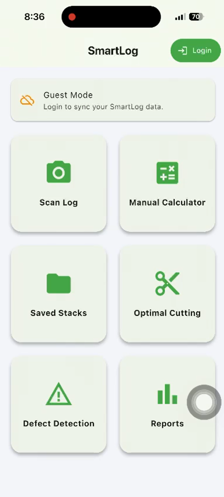
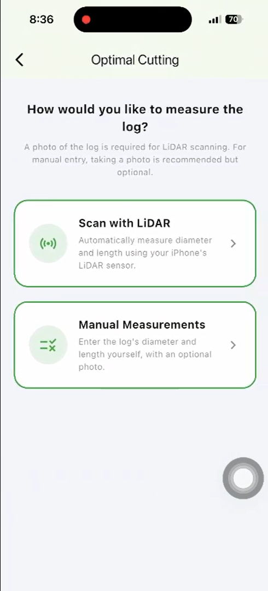
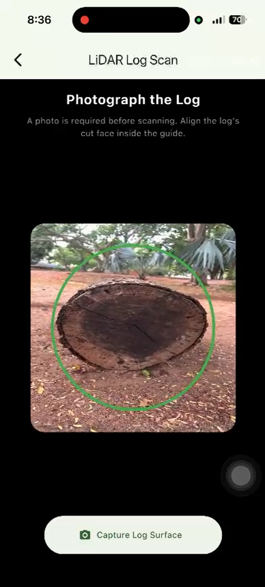
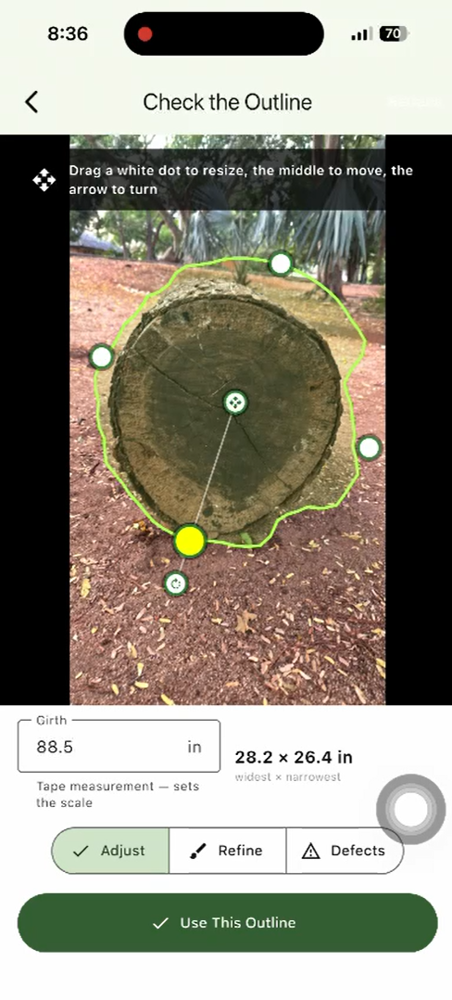
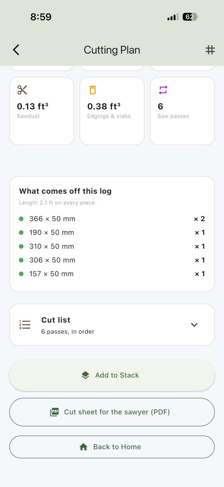

# SmartLog – Mobile-Based Timber Measurement and Cutting Optimisation System

<p align="center">
  
</p>

<p align="center">
  <strong>A mobile-based solution for timber log measurement, defect assessment, and cutting optimisation.</strong>
</p>

---

## 📌 Project Overview

**SmartLog** is a mobile application developed to support timber measurement and processing by combining mobile LiDAR technology, computer vision, and cutting optimisation techniques.

Traditional timber measurement and cutting processes often depend on manual measurements and visual inspections. These approaches can be time-consuming and may lead to inconsistent measurements and material wastage.

SmartLog aims to simplify these processes by providing a mobile platform that supports log measurement, timber volume calculation, defect assessment, and cutting-plan generation.

The system is designed to support small and medium-sized timber businesses by bringing important timber-processing activities together within a single application.

## 🎯 Project Objectives

- Develop a mobile-based solution for measuring timber logs using smartphone LiDAR technology.
- Provide manual measurement and timber volume calculation facilities.
- Develop a deep-learning-based approach to identify visible timber defects.
- Generate suitable timber cutting arrangements while considering log geometry and defect information.
- Maintain timber measurement records and support report generation.
- Support local data storage and cloud-based synchronisation.

## ✨ Key Features

### 1. LiDAR-Based Log Measurement
- Capture timber log surfaces using the LiDAR sensor of supported iPhone devices.
- Generate and process 3D point cloud data.
- Estimate log length and diameter profiles.
- Calculate timber volume using supported measurement methods.

### 2. Manual Timber Calculator
- Enter timber measurements manually.
- Calculate timber volume without requiring LiDAR scanning.
- Support timber measurement when LiDAR scanning is unavailable.

### 3. Defect Detection
- Develop a YOLOv8-based deep learning model for identifying visible timber defects.
- Consider three defect categories:
  - Cracks
  - Holes
  - Knots
- Evaluate detection performance using object detection metrics such as precision, recall, F1-score, and mAP.

### 4. Optimal Cutting
- Generate cutting arrangements based on the log-face geometry.
- Consider user-defined board dimensions and blade thickness.
- Support defect exclusion regions in cutting arrangements.
- Compare cutting arrangements and estimate timber utilisation and waste.

### 5. Saved Timber Records
- Store measured timber information locally.
- Maintain saved timber stacks and associated records.
- Retrieve previously saved information.

### 6. Reports
- Generate reports containing timber measurement and cutting information.
- Export cutting sheets as PDF documents.
- Support report management.

### 7. Offline Storage and Cloud Synchronisation
- Use SQLite for local data storage.
- Support core local record-management operations without continuous internet connectivity.
- Use Firebase Authentication for user authentication.
- Use Cloud Firestore for cloud-based data synchronisation when network connectivity is available.

---

## 📱 Application User Interface

The following screenshots showcase the main SmartLog application interfaces and selected workflows.

### 1. Home Screen

The home screen provides access to the main application features, including log scanning, manual calculation, saved stacks, optimal cutting, defect detection, and reports.

<p align="center">
  
</p>

### 2. Measurement Method Selection

Users can select LiDAR scanning or manual measurements depending on the available device capabilities and measurement requirements.

<p align="center">
  
</p>

### 3. LiDAR Log Scanning

The application captures a photograph of the log surface before performing the LiDAR scanning process.

<p align="center">
  
</p>

### 4. Log Outline Adjustment

Users can review and adjust the detected log-face outline. The measured girth is used to establish the physical scale of the traced outline.

<p align="center">
  
</p>

### 5. Cutting Plan Generation

The application presents cutting arrangements and compares the available cutting strategies, including live sawing and cant sawing.

<p align="center">
  
</p>

### 6. Cutting Details and Reports

The cutting details screen presents information about the generated boards, estimated waste, saw passes, and available cutting-sheet export options.

<p align="center">
  
</p>

---

## ⚙️ Technology Stack

| Component | Technologies |
|---|---|
| Mobile Application | Flutter, Dart |
| Native iOS Integration | Swift, Apple ARKit |
| LiDAR Processing | ARKit Scene Depth, Point Cloud Processing |
| Defect Detection Model | Python, YOLOv8, Ultralytics |
| Model Training | Google Colab, PyTorch |
| Local Database | SQLite |
| Cloud Database | Firebase Cloud Firestore |
| Authentication | Firebase Authentication |
| Report Generation | PDF and CSV export |
| Version Control | Git and GitHub |

---

## 🧠 Defect Detection Model

SmartLog includes a separately developed YOLOv8-based object detection model for identifying visible timber defects.

The model focuses on three defect categories:

| Defect Class | Description |
|---|---|
| Crack | Visible cracks on timber surfaces |
| Hole | Holes and hollow regions |
| Knot | Visible knots on timber surfaces |

Four YOLOv8 configurations were evaluated during model development:

- YOLOv8n
- YOLOv8m
- YOLOv8s
- YOLOv8s with additional augmentation

The YOLOv8s configuration trained using Dataset B was selected based on its overall validation performance.

**Selected model validation results:**

| Metric | Result |
|---|---:|
| Precision | 63.0% |
| Recall | 53.7% |
| F1-score | 58.0% |
| mAP@50 | 56.3% |
| mAP@50–95 | 28.6% |
| Inference time | 10.2 ms/image |

The model was trained using Google Colab with an NVIDIA Tesla T4 GPU and exported in TensorFlow Lite format.

*Note: The model was developed and evaluated separately from the current mobile cutting workflow. Automatic transfer of YOLOv8 predictions into the cutting optimisation process is not represented as a completed integration.*

---

## 🏗️ System Workflow

The SmartLog workflow can be summarised as follows:

```text
                 Timber Log
                      |
                      v
              Measurement Method
                      |
             +--------+--------+
             |                 |
             v                 v
         LiDAR Scan       Manual Entry
             |                 |
             +--------+--------+
                      |
                      v
             Log Measurements
                      |
                      v
             Defect Assessment
                      |
                      v
             Cutting Optimisation
                      |
                      v
               Cutting Plan
                      |
             +--------+--------+
             |                 |
             v                 v
        Save Records       Generate Reports
             |
             v
       SQLite Database
             |
             v
      Firebase Synchronisation
```

---

## 🛠️ Installation and Setup

### Prerequisites

Before running the project, ensure that the following tools are installed:

- Flutter SDK
- Dart SDK
- Android Studio or Visual Studio Code
- Xcode for native iOS development
- Git

For LiDAR-based scanning, a supported LiDAR-equipped iPhone is required.

### 1. Clone the Repository

```bash
git clone <YOUR_GITHUB_REPOSITORY_URL>
```

### 2. Navigate to the Project Directory

```bash
cd SmartLog
```

### 3. Install Dependencies

```bash
flutter pub get
```

### 4. Configure Firebase

Configure Firebase for the application using the appropriate Firebase project configuration files.

Ensure that the required Firebase services are enabled:

- Firebase Authentication
- Cloud Firestore

### 5. Run the Application

Connect a supported device or start an emulator and execute:

```bash
flutter run
```

**Note:** LiDAR scanning requires compatible physical hardware and is not available on standard emulators.

---

## 📂 Project Structure

The project is organised into the following main directories:

```text
SmartLog/
│
├── android/                 # Android platform configuration
├── ios/                     # iOS platform and native integrations
│   └── Runner/
│       └── LidarScanner/    # Native LiDAR scanning implementation
│
├── lib/
│   ├── assets/              # Application assets and model files
│   ├── screens/             # Application UI screens
│   ├── services/            # Application services and business logic
│   ├── utils/               # Utility functions and geometry processing
│   └── ...
│
├── test/                    # Application tests
├── assets/
│   └── app-ui/              # Application screenshots
│
├── pubspec.yaml             # Flutter dependencies and configuration
└── README.md                # Project documentation
```

---

## 🔮 Future Improvements

Potential future improvements include:

- Integrating YOLOv8 inference directly into the mobile application.
- Mapping detected defect locations to the physical log coordinate system.
- Improving crack detection performance through additional training data.
- Expanding field testing under different environmental conditions.
- Improving cutting optimisation with more advanced geometric and sawing constraints.
- Conducting further performance and usability evaluations.

---

## 🎓 Academic Project Information

**Project Name:** SmartLog – Mobile-Based Timber Measurement and Cutting Optimisation System

**Module:** ICT 3411 – Final Year Group Project

**University:** Rajarata University of Sri Lanka

**Faculty:** Faculty of Applied Sciences

**Department:** Department of Computing

**Academic Year:** 2026

---

## 👥 Project Team

| Name | Student ID |
|---|---|
| H.M.S.S.W. Bandara | ICT/2022/145 |
| A.K.A. Sanjula | ICT/2022/093 |
| S.M.S.C. Seneviratne | ICT/2022/086 |
| K.G.T.N. Bandara | ICT/2022/081 |
| R.S.R. Ranathunga | ICT/2022/139 |

**Project Supervisor:** Mrs. A.K.N.L. Aththanagoda

---

## 📄 License

This project was developed for academic purposes as part of the final-year group project at Rajarata University of Sri Lanka.

A formal open-source license has not yet been specified.
